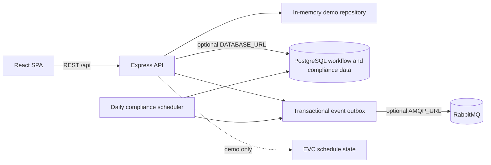

# Prototype architecture

EVC schedules remain in-process demo data. Undertakings, compliance document metadata, and deduplicated alert records use PostgreSQL when configured, with in-memory equivalents for local use. Evidence validation checks metadata and a text description; private file storage, file scanning, and email/SMS delivery are not connected. Authentication, cloud deployment, and monitoring are also not connected. The production architecture needs team agreement on APH routing, IdP, provider, privacy controls, and service ownership.
