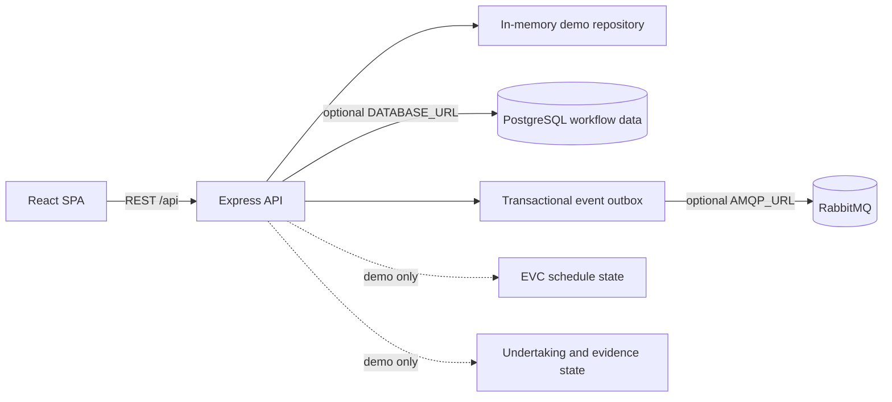

# Prototype architecture

EVC and compliance are currently in-process demo data. Authentication, private document storage, notification delivery, cloud deployment, and monitoring are not connected. The production architecture needs team agreement on APH routing, IdP, provider, privacy controls, and service ownership.
